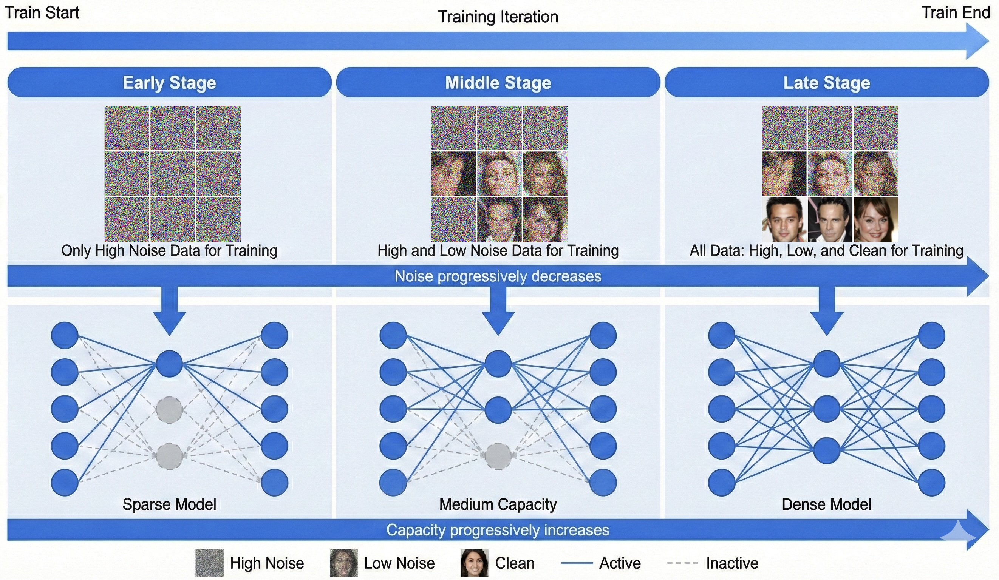
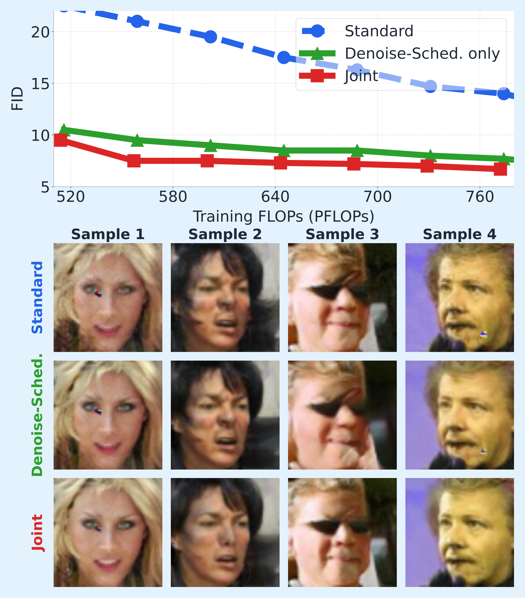

# A Theoretical Analysis of Curriculum Training in Diffusion Models

**ICML 2026 · Workshop on Foundations of Deep Generative Models (FoGen)**

Jiawei Sun, Shuai Zhang, Hongkang Li, Sijia Liu, Pin-Yu Chen, Meng Wang

[Paper](https://openreview.net/forum?id=AxbjagGhku) · [Project page](https://sun-messi.github.io/projects/diffusion-curriculum/) · [Jiawei Sun](https://sun-messi.github.io/)



*Joint curriculum overview from the local manuscript: progressively introduce lower-noise examples while increasing active model capacity.*

## Research question

When should a denoiser learn coarse structure, and when should it learn finer features? We study the interaction between the noise distribution seen during training and available model capacity. The theory concerns a structured data/model setting; it does not establish that every practical model learns perfectly disentangled features.

This repository contains the U-ViT implementation and experimental utilities. It does not include every architecture or experiment in later local manuscript revisions.

## Results



*Standard training, denoising schedule only, and joint scheduling. The horizontal axis is training FLOPs (PFLOPs); sample panels are at 200k steps. Reproduced from the local manuscript figure used on the project page, not a newly run experiment.*

The previous README's standalone FID table is no longer presented as a verified current result. Read numerical values and experimental scope from the linked paper and the figure. [Figure provenance and reproduction limits](docs/REPRODUCTION.md).

## Installation and data

```bash
python -m venv .venv
source .venv/bin/activate
python -m pip install -r requirements.txt
```

Install a matching CUDA-enabled PyTorch/torchvision pair for GPU runs. The dependency list describes the core image-training path, not a validated lockfile for every inherited text-to-image utility. Optional xformers is not required for the fallback attention implementation.

Prepare CelebA images at `assets/datasets/celeba` (or override `config.dataset.path`) and the FID reference statistics required by `datasets.py`. Do not substitute a different reference split or number of samples without recording it. Model weights, datasets and FID statistics are not bundled.

## Training

Run from the repository root. Explicit work directories avoid ambiguity when resuming/evaluating.

```bash
# Standard training
accelerate launch --multi_gpu --num_processes 4 --mixed_precision fp16 \
  train.py --config=configs/celeba64_uvit_small.py --workdir=workdir/standard

# Noise curriculum only
accelerate launch --multi_gpu --num_processes 4 --mixed_precision fp16 \
  train_c.py --config=configs/celeba64_uvit_small_c.py --workdir=workdir/noise

# Joint noise and sparsity curriculum
accelerate launch --multi_gpu --num_processes 4 --mixed_precision fp16 \
  train_c.py --config=configs/celeba64_uvit_small_cs.py --workdir=workdir/joint
```

These are entry-point examples, not a guarantee of identical paper results. Check each config's batch size, optimizer, sampling settings and data path before comparing methods. The joint config has batch size 252, embedding dimension 256 and 200k total steps. Its stage sparsity begins at 0.15 (**15% masked, about 85% active**), not 15% active capacity.

## What the implementation actually masks

`train_c.py` attaches an `EmbeddingSparsityMask` **after patch embedding** for the training network and EMA network. It does not install a second decoder mask. The mask is disabled for sampling/evaluation. This is activation masking, not physical removal of transformer weights or demonstrated sparse-kernel acceleration.

`LSimple_curriculum` in `train_c.py` samples time uniformly within the stage's interval. Configured time is a continuous SDE parameter; t=1 should not be read as an assertion of mathematically pure noise.

Stage counts, time intervals and sparsity values live in the config files. No default training schedules or checkpoint formats were changed in this refresh.

## Evaluation

```bash
accelerate launch --multi_gpu --num_processes 4 --mixed_precision fp16 \
  eval.py --config=configs/celeba64_uvit_small_cs.py \
  --nnet_path=workdir/joint/ckpts/200000.ckpt/nnet.pth
```

Set the checkpoint path to the actual saved file. FID depends on reference statistics, sample count and sampler; record all three. The checked-in joint config uses 2,000 evaluation samples.

## Repository map

| Entry | Purpose |
| --- | --- |
| `train.py` | Standard continuous-time training |
| `train_c.py` | Curriculum training, mask hooks and diagnostics |
| `libs/curriculum.py` | Independently testable embedding mask and time-range validation |
| `configs/celeba64_uvit_small*.py` | Standard, noise, joint and regularization variants |
| `libs/uvit.py` | U-ViT backbone |
| `sde.py`, `dpm_solver_pytorch.py` | Diffusion process and sampler |
| `eval.py`, `tools/` | Sampling and FID |
| `*jacobian*.py`, `visualize_*.py` | Exploratory analysis utilities |
| `tests/`, `docs/` | Regression tests and reproduction notes |

## Tests

```bash
python -m unittest discover -s tests -v
python -m compileall -q .
```

Tests assert masking, gradients, inference bypass and invalid input handling on CPU. They do not reproduce FID or validate distributed training.

## Citation and acknowledgements

```bibtex
@inproceedings{sun2026curriculum,
  title={A Theoretical Analysis of Curriculum Training in Diffusion Models},
  author={Sun, Jiawei and Zhang, Shuai and Li, Hongkang and Liu, Sijia and Chen, Pin-Yu and Wang, Meng},
  booktitle={ICML Workshop on Foundations of Deep Generative Models},
  year={2026},
  url={https://openreview.net/forum?id=AxbjagGhku}
}
```

Built on [U-ViT](https://github.com/baofff/U-ViT), [DPM-Solver](https://github.com/LuChengTHU/dpm-solver) and [Extended Analytic-DPM](https://github.com/baofff/Extended-Analytic-DPM). Please also cite these upstream works when using their components. See [LICENSE](LICENSE).
